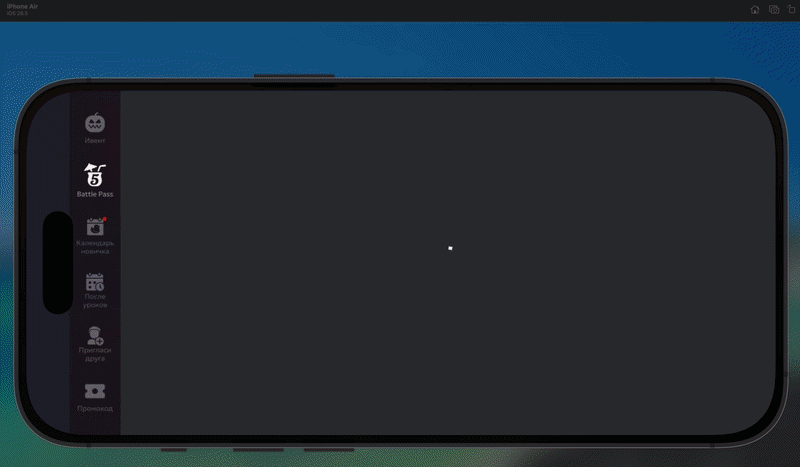

# Battle Pass — тестовое задание

Экран боевого пропуска по [макету в Figma](https://www.figma.com/design/cCWtK0v3plrmwvPO9DZCRU/%D0%A2%D0%B5%D1%81%D1%82%D0%BE%D0%B2%D0%BE%D0%B5-%D0%B7%D0%B0%D0%B4%D0%B0%D0%BD%D0%B8%D0%B5-%C2%B7-Flutter),
Flutter + flutter_bloc (Cubit), данные из мока.



## Как запустить

```bash
flutter pub get
make generate          # freezed / json_serializable / injectable
make run               # flutter run --flavor development -t lib/main_development.dart
```

Флейворы: `development`, `staging`, `production` (`lib/main_*.dart`).
Прочие команды — `make analyze`, `make test`, `make format`.

**Экран ландшафтный.** Ориентация залочена в `bootstrap.dart`: макет нарисован под
кадр 2320×1080, портретной версии в Figma нет, и придумывать её за дизайнера — не то же
самое, что сверстать по макету.

## Переключение состояний

Внизу экрана — пилюля **«Состояние: …»**, по тапу циклически переключает мок-пейлоады:

1. Премиум не куплен
2. Премиум куплен · есть награда к получению
3. Максимальный уровень
4. Пропуск завершён (награды ещё можно забрать)

Сделано именно подменой **ответа сервера** (`BattlePassScenario` в мок-провайдере), а не
флагом внутри кубита. Экран не знает, что состояний четыре: он рисует тот `BattlePass`,
который ему выдали. Продакшн-путь остаётся единственным путём.

Кроме того, состояния достижимы «по-честному»: кнопки «Прокачать», «Повысить уровень»,
«Забрать» и «Забрать все награды» меняют пейлоад через репозиторий.

## Схема данных

Полный proto-подобный набросок с комментариями к каждому полю — [`docs/data_schema.md`](docs/data_schema.md).

Коротко, чем руководствовался:

- **Состояние экрана выводится из данных, а не приходит отдельным «режимом».**
  `premiumOwned` разводит «куплен / не куплен», `level == maxLevel` — максимальный
  уровень, `claimDeadline > 0` — завершённый сезон. Рассинхрон экрана с бэкендом
  становится невозможным по построению.
- **Правая панель — одна структура `Promo`**, а не три ветки: в макете это один и тот же
  прямоугольник, который до покупки продаёт пропуск, после — уровни, а на максимуме гаснет.
- **`locked / available / claimed` — свойство уровня, а не награды**: в слоте лежит пачка
  предметов, но кнопка «Забрать» одна.
- **Времена абсолютные** (`endsAt`, `claimDeadline`, `expiresAt`), а не «осталось N».
  Таймеры тикают на клиенте и не врут после сворачивания приложения.

## Структура

```
lib/
  app/router/               — AutoRoute: router.dart, router_names.dart
  app/view/                 — App и BattlePassScope (владелец кубита)
  common/
    extensions/             — тиры наград, ключи ассетов, таймеры, лейблы состояний
    ui/{atoms,components}/  — общий UI-кит: VGPressable, VGCtaButton, VGSkewedCard…
    ui/extensions/          — context.colors / textStyles / s(…)
    utils/                  — миксины (PeriodicRebuildMixin, BattlePassActionsMixin)
  data/battle_pass/
    models/<имя>/           — freezed-модели, по папке на модель
    repository/             — абстракция
    provider/               — @LazySingleton(as:) реализация с моками
  features/<фича>/
    bloc/<имя>_cubit/       — кубит + состояния
    view/{pages,components,widgets}/
  services/                 — расчёты (геометрия и прогресс дорожки)
  theme/                    — ColorsScheme, AppTextStyles, AppLayout, AppDimens, AppDurations
```

Приватных виджетов нет: каждый — публичный класс в своём файле.

### Масштабирование

Размеры записаны в координатах кадра Figma (2320×1080) и переводятся в пиксели через
`context.s(…)`. Значения снимались из Figma REST API, а не на глаз.

Масштаб вписывается **по обеим осям** (`min(h/1080, w/2320)`). Если брать только высоту,
любой экран пропорционально уже макета переполняется: iPad в ландшафте требовал бы на
~600px больше ширины, чем у него есть. Запас по свободной оси уходит в воздух, который
добирают `Flexible`-полосы, а не в обрезанный контент.

Раскладка построена на `Row/Column/Expanded/Flexible/ConstrainedBox`. Абсолютное
позиционирование осталось только там, где это оверлей по смыслу — значки на карточке
награды, подпись поверх арта героя. Дорожка наград — ленивый `ListView.builder` из равных
слотов: схема допускает сотню уровней, а ряд, расставляющий карточки по `index * ширина`,
строит их все сразу и пересчитывает геометрию при любом изменении.

## Анимации

Макет статичен, поэтому оживление — решение на мою сторону:

- герой в центре медленно дышит и подсвечивается, смена уровня — кросс-фейд арта;
- дорожка «раздаёт» карточки каскадом слева направо и паркуется на текущем уровне;
- прокачка играется последовательностью: кольцо добегает до конца, номер щёлкает,
  и только потом заливка стартует с нуля — иначе она поехала бы назад, ведь покупка
  уровня обнуляет опыт;
- выбранная карточка приподнимается над рядом, края дорожки растворяются, а не режутся;
- карточка заданий сама листает список — под неё в макете нарисованы пять точек-индикаторов;
- все нажимаемые элементы отвечают на палец единым `Pressable`;
- смена состояния экрана и арта правой панели — через `AnimatedSwitcher`;
- таймеры тикают вживую, под час переключаются на секунды.

## Что решено за макет

- **Уровень в кольце.** В Figma в кольце «22» при дорожке из 10 уровней с пинами 1…10 —
  два разных счётчика в одном экране. Свёл к одному: кольцо показывает текущий уровень
  дорожки, пины — её же нумерацию.
- **Состояний в Figma больше трёх.** Кроме перечисленных в задании есть «завершён» и
  «конец наград». Реализовал четыре, включая «завершён»; «конец наград» — это тот же
  экран, доскролленный вправо, отдельного состояния не потребовал.
- **Нажатые состояния, скролл и пустые ветки** в макете не нарисованы — сделал по смыслу.
- **Набор иконок на дорожке в макете разный от кадра к кадру.** Под одним и тем же пином
  в разных состояниях нарисованы разные предметы, поэтому «правильного» порядка из макета
  не выводится.
- **Кнопка «Забрать опыт» на карточке заданий читается как неактивная.** В Figma у неё
  зелёный градиент `#55B675 → #449761`, а подпись — `#68C286`, то есть светло-зелёный по
  зелёному. Контраст низкий, и на глаз непонятно, кликабельна ли она. Оставил как нарисовано
  и не стал «чинить» дизайн: вопрос вынесен сюда, а живость даёт отклик на нажатие.
- **Поведение цветов на максимальном уровне из макета не читается.** В кадре не показано,
  как должны меняться состояния элементов, когда сезон упёрся в потолок, — оставил ту же
  палитру, погасив только кнопку повышения.
- **Нужна ли кнопка «Забрать» на максимальном уровне, в макете не сказано.** Решил, что
  нужна: награды за уже взятые уровни никуда не деваются, и без кнопки их нечем забрать.
  Она есть на каждом доступном уровне, а рядом с промо-панелью работает «Забрать все
  награды».

## Что не успел и что осознанно оставил за скобками

### Ассеты, упёршиеся в rate limit Figma

- **Статус-бар выгрузить не удалось.** Доступными способами эта нода из Figma не
  экспортируется, поэтому в макете она осталась незакрытой. На устройстве её место занимает
  системный вырез, и навигационная панель рассчитана так, чтобы он попадал внутрь неё —
  как и нарисовано в кадре.
- **Левый навбар — одна картинка в низком разрешении.** Это чужой для боевого пропуска
  элемент игровой оболочки, поэтому одиннадцать пунктов меню я не переписывал. На боевом
  проекте это шесть отдельных иконок.

### Значения, которые API не отдаёт

- **Радиус плашки «Получи все сразу!»** подобран (20). Плашка — векторный путь, у него нет
  `cornerRadius`, а геометрию через API не достать. Остальные её значения точные: заливка
  `#E29432` при 30%, текст `#FFD149` 30/500 со свечением `#FF5C00` blur 14.4.

### Не сделано

- **Экран «Задания» — по мотивам макета**, без варианта «бафф + к опыту».
- **Покупка премиума** не спрашивает подтверждения и не ходит в платёжку.
- **Бэкенд и кэш.** Мок сидит за абстракцией `BattlePassRepository`: подмена на retrofit —
  это правка тел методов провайдера, выше по стеку ничего не меняется.
- **Локаль зафиксирована на `ru`.** Все строки идут через `context.l10n` и лежат в arb
  (`ru` + `en`), но приложение не отдаёт выбор языка системе — макет и тексты сезона
  русские, и смешанный экран выглядел бы хуже. Снимается удалением одной строки в `App`.

### Известные ограничения по данным

- **`x16` у всех наград** — так в макете; количество приходит полем `amount`, но осмысленных
  значений в кадре нет, поэтому в моке оно одинаковое.
- **`acc_11200` встречается в макете дважды** (уровни 3 и 9) — это не моя ошибка
  дедупликации, а так нарисовано; в моке повтор сохранён.

## Использование ИИ

Задание выполнено в Claude Code (Opus). Как применял:

- разбор PDF и макета: чтение кадров и выгрузка точных значений (цвета, размеры,
  типографика, геометрия дорожки) через Figma REST API — вместо снятия на глаз;
- экспорт ассетов и шрифта, генерация скаффолда через Very Good CLI;
- написание кода: модели, кубит, виджеты;
- проверка: `flutter analyze`, тесты и работа с запущенным приложением через Dart MCP —
  дерево виджетов и рантайм-ошибки читались из живого процесса, hot reload оттуда же.
  Так нашлись, например, перехват тапов `DecoratedBox` и `Flexible` рядом со `Spacer`;
- решения по архитектуре (вывод состояния из данных, единая `Promo`, лоток отдельным
  списком, масштаб по обеим осям) и по спорным местам макета принимал сам.
